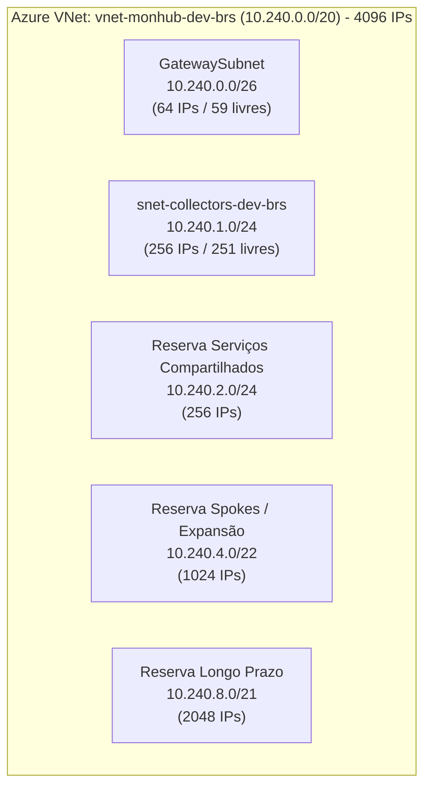
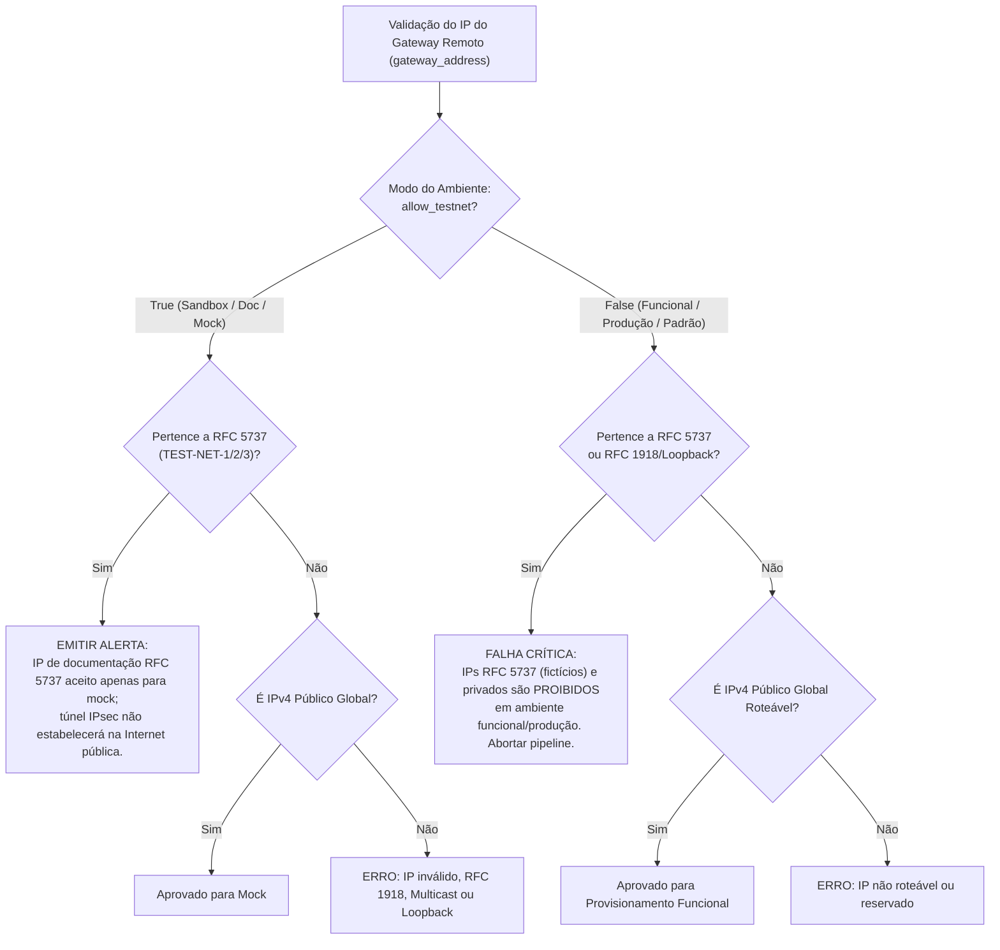
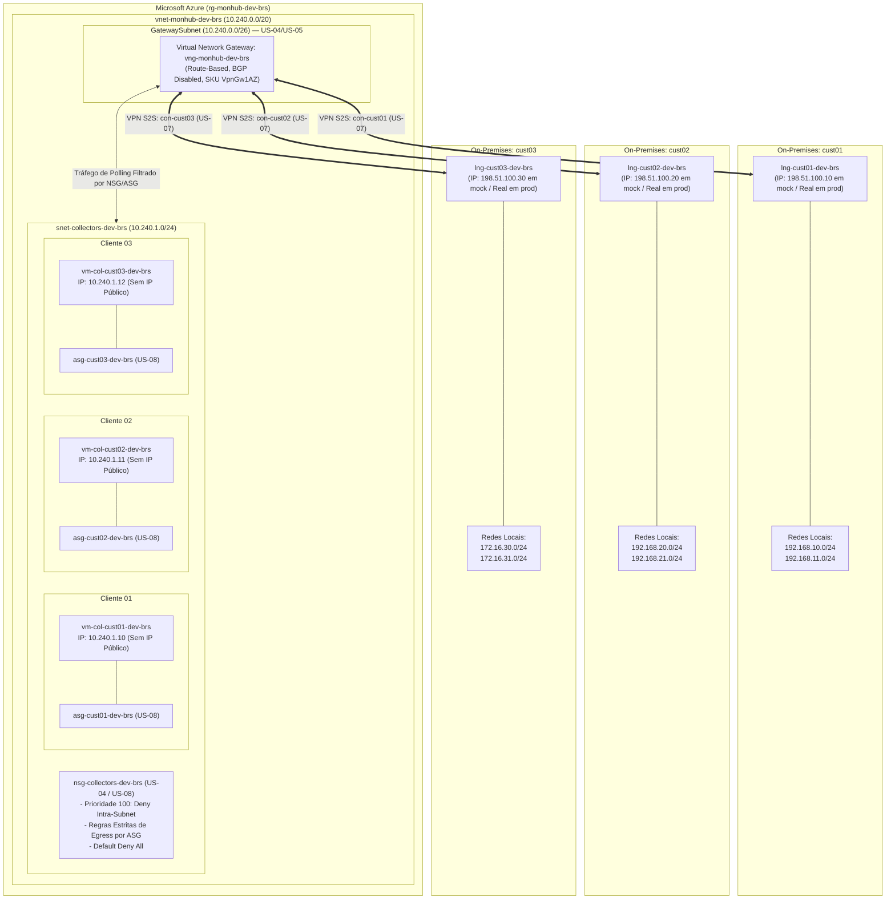

# Plano de Endereçamento, Validação de CIDR e Modelo de Isolamento (US-06)

- **Status**: Revisado e Proposto para Aprovação Humana (Revisão Arquitetural V1.1)
- **Data da Última Revisão**: 2026-10-09
- **Data Original**: 2026-10-09
- **Autor / Papel**: Cloud Architect — Azure Monitoring Hub
- **Contexto da História**: [US-06: Validação Automatizada de Sobreposição de Blocos CIDR (Overlap Detection)](file:///C:/Users/drlim/ENTERPRISE-CLOUD-CASE-STUDIES/azure-monitoring-hub/docs/backlog/BACKLOG.md#us-06-validação-automatizada-de-sobreposição-de-blocos-cidr-overlap-detection)
- **Documentos Relacionados**: [ARCHITECTURE.md](file:///C:/Users/drlim/ENTERPRISE-CLOUD-CASE-STUDIES/azure-monitoring-hub/docs/architecture/ARCHITECTURE.md) | [ADR-001-vng-sku.md](file:///C:/Users/drlim/ENTERPRISE-CLOUD-CASE-STUDIES/azure-monitoring-hub/docs/architecture/adr/ADR-001-vng-sku.md)

---

## 1. Visão Geral e Justificativa Técnica

No **Azure Monitoring Hub** (`monhub`), múltiplos clientes remotos conectam suas redes locais à plataforma de monitoramento centralizada através de um **Azure Virtual Network Gateway compartilhado** (`vng-monhub-dev-brs`), operando com VPN Site-to-Site IKEv2 sob o modelo **Route-Based** sem NAT (*Network Address Translation*).

Nessa topologia:
1. As tabelas de rotas do Azure e das redes locais aprendem os prefixos remotos diretamente.
2. A existência de qualquer colisão de endereçamento IP (seja entre o Azure e um cliente, ou entre dois clientes concorrentes) gera conflitos imediatos na FIB (*Forwarding Information Base*), descarte de pacotes, instabilidade de túneis e sérios riscos de segurança por vazamento de telemetria.
3. Para garantir governança e segurança determinística:
   - Estabelece-se um **desenho padronizado e disjunto de endereçamento** para os clientes fictícios do laboratório (`cust01`, `cust02`, `cust03`);
   - Define-se a **diferenciação explícita entre endereços fictícios de teste (RFC 5737 TEST-NET) e endereços públicos reais**, parametrizando o validador para impedir que dados fictícios sejam promovidos para ambientes funcionais ou produtivos;
   - **Revisa-se formalmente o comportamento do Azure VPN Gateway**: o isolamento multi-tenant **não depende de suposições implícitas** do gateway, mas sim de uma arquitetura de defesa em profundidade (*Defense in Depth*) com **controles verificáveis de roteamento, NSG/ASG e firewall**, distinguindo rigorosamente o que já está provisionado do que será entregue nas histórias subsequentes.

---

## 2. Mapa Global de Endereçamento do Hub Azure

A infraestrutura na nuvem opera sob faixas privadas RFC 1918 fictícias, definidas na V1 ([ARCHITECTURE.md](file:///C:/Users/drlim/ENTERPRISE-CLOUD-CASE-STUDIES/azure-monitoring-hub/docs/architecture/ARCHITECTURE.md)):



| Segmento de Rede | Bloco CIDR | Faixa IP (Início — Fim) | Total IPs | Associação e Governança |
| :--- | :--- | :--- | :---: | :--- |
| **Super-bloco VNet** | `10.240.0.0/20` | `10.240.0.0` — `10.240.15.255` | 4.096 | Espaço de endereçamento oficial de `vnet-monhub-dev-brs`. |
| **`GatewaySubnet`** | `10.240.0.0/26` | `10.240.0.0` — `10.240.0.63` | 64 | Reservada exclusivamente ao VNG (`vng-monhub-dev-brs`). **Sem NSG** (conforme Azure best practice). |
| **Subnet de Collectors** | `10.240.1.0/24` | `10.240.1.0` — `10.240.1.255` | 256 | Hospeda as NICs privadas estáticas dos coletores Windows. Associada ao `nsg-collectors-dev-brs`. |
| *Reserva de Serviços* | `10.240.2.0/24` | `10.240.2.0` — `10.240.2.255` | 256 | Reserva contígua para serviços compartilhados futuros (Private Endpoints, Log Analytics). |
| *Reserva de Spokes* | `10.240.4.0/22` | `10.240.4.0` — `10.240.7.255` | 1.024 | Reserva livre para novos pools de coletores ou VNets pareadas. |
| *Reserva Longo Prazo* | `10.240.8.0/21` | `10.240.8.0` — `10.240.15.255` | 2.048 | Espaço não alocado dentro do bloco `/20`. |

---

## 3. Desenho de Endereçamento dos Clientes Fictícios (`cust01`, `cust02`, `cust03`)

Preservam-se integralmente os CIDRs remotos e IPs privados estáticos aprovados para os clientes fictícios:

### 3.1 Mapeamento Técnico de Endereçamento

| Cliente ID | Nome Fictício | IP Privado do Coletor (`snet-collectors`) | Redes Remotas do Cliente (CIDRs On-Premises) | IP Público do Gateway Remoto (Simulado em Lab / Doc) | IP Público do Gateway Remoto (Ambiente Real / Produção) |
| :---: | :--- | :---: | :--- | :---: | :---: |
| **`cust01`** | Cliente Alpha | `10.240.1.10` | `192.168.10.0/24` *(Core/App)*<br>`192.168.11.0/24` *(Mgmt/Infra)* | `198.51.100.10` *(RFC 5737)* | IP Público Global Roteável fornecido pelo cliente |
| **`cust02`** | Cliente Beta | `10.240.1.11` | `192.168.20.0/24` *(App/DB)*<br>`192.168.21.0/24` *(DMZ/Interna)* | `198.51.100.20` *(RFC 5737)* | IP Público Global Roteável fornecido pelo cliente |
| **`cust03`** | Cliente Gamma | `10.240.1.12` | `172.16.30.0/24` *(Matriz/Corp)*<br>`172.16.31.0/24` *(IoT Industrial)* | `198.51.100.30` *(RFC 5737)* | IP Público Global Roteável fornecido pelo cliente |

---

## 4. Diferenciação de IPs Públicos: RFC 5737 (TEST-NET) vs. Conectividade Real

### 4.1 Limitação Técnica dos Blocos RFC 5737
Os blocos definidos pela RFC 5737:
- `192.0.2.0/24` (TEST-NET-1)
- `198.51.100.0/24` (TEST-NET-2)
- `203.0.113.0/24` (TEST-NET-3)

são reservados pela IANA exclusivamente para documentação, exemplos técnicos e laboratórios sintéticos.

> [!WARNING]
> **Impossibilidade de Conectividade Funcional com IPs RFC 5737**:
> Os blocos RFC 5737 **não são roteáveis na Internet pública**. Roteadores de trânsito e provedores de backbone descartam pacotes destinados a essas faixas. Caso um Local Network Gateway seja provisionado com um IP da RFC 5737, o Azure aceitará a sintaxe no plano de gerenciamento, mas **o túnel IPsec IKEv2 nunca completará a negociação (IKE Phase 1)** em um ambiente conectado à Internet pública.
> Para conexões VPN funcionais reais, o gateway remoto deve obrigatoriamente possuir um **endereço IPv4 público globalmente roteável** (Global Unicast).

### 4.2 Governança do Validador de Overlap (US-06) por Modo de Execução

Para garantir flexibilidade de estudo sem comprometer a segurança operacional, o script de validação de sobreposição implementará uma verificação condicionada ao **modo de execução do ambiente**:



#### Regras Operacionais do Validador:
1. **Modo Sandbox / Documentação (`allow_testnet = true` ou flag `--allow-testnet`)**:
   - Permite endereços da RFC 5737 exclusivamente para validação sintática do Terraform, testes de pipeline de CI/CD e demonstração de portfólio;
   - Emite um aviso (*Warning*) no log do pipeline explicitando que o túnel não negociará conectividade real.
2. **Modo Funcional / Produção (`allow_testnet = false` — Comportamento Padrão de Governança)**:
   - **Bloqueio Absoluto**: Se qualquer cliente possuir `gateway_address` pertencente à RFC 5737, RFC 1918, RFC 3927 (APIPA), RFC 1112 (Multicast) ou faixas reservadas (RFC 6890), o script **aborta imediatamente com erro de validação (Exit Code != 0)** antes do `terraform plan`;
   - Exige que o endereço pertença estritamente ao espaço IPv4 Global Unicast (`ip.is_global and not ip.is_private and not ip.is_reserved`);
   - Garante que configurações fictícias de laboratório nunca sejam promovidas acidentalmente para produção.

---

## 5. Critérios Formais e Algoritmo de Validação de Sobreposição (US-06)

O script automatizado da US-06 deve executar quatro validações matemáticas sequenciais:

```
[Parâmetros de Entrada]
       │
       ▼
(1. Formato & RFC 1918) ──► Rejeita se máscara fora de /8-/29 ou bits de host ativos
       │
       ▼
(2. VNet Hub Overlap)   ──► Rejeita se R ∩ 10.240.0.0/20 ≠ ∅ (Igualdade, Subnet, Supernet)
       │
       ▼
(3. Inter-Customer)     ──► Rejeita se R_novo ∩ R_existente ≠ ∅ (Entre quaisquer clientes)
       │
       ▼
(4. Gateway Remoto)     ──► Valida unicidade e roteabilidade conforme modo allow_testnet
       │
       ▼
[Aprovado para Terraform Plan]
```

### 5.1 Regra 1: Validação Estrutural e RFC 1918 Estrita
- Cada prefixo remoto deve ser um bloco IPv4 no formato `A.B.C.D/M` ($8 \le M \le 29$).
- O endereço informado deve ser estritamente o endereço de rede (`strict=True`), rejeitando bits de host ativos (ex.: rejeita `192.168.10.15/24`, exige `192.168.10.0/24`).
- Deve pertencer integralmente ao espaço privado da RFC 1918 (`10.0.0.0/8`, `172.16.0.0/12` ou `192.168.0.0/16`).

### 5.2 Regra 2: Inviolabilidade da VNet Hub (Azure Overlap)
- O espaço do hub é o super-bloco **`10.240.0.0/20`**.
- Para todo bloco remoto $R$ declarado:
  $$R \cap \text{10.240.0.0/20} = \emptyset \quad (\text{not } R.\text{overlaps}(\text{10.240.0.0/20}))$$
- Detecta e bloqueia:
  - **Igualdade**: requisitar `10.240.0.0/20`;
  - **Sub-rede contida**: requisitar sub-redes internas a `10.240.0.0/20` (ex.: `10.240.1.0/24`, `10.240.0.0/26`);
  - **Super-rede abrangente**: requisitar super-redes que englobem a VNet (ex.: `10.240.0.0/16`, `10.0.0.0/8`).

### 5.3 Regra 3: Não-Sobreposição Inter-Clientes (Customer-to-Customer Overlap)
- Nenhum cliente pode utilizar prefixos que interceptem prefixos de outros clientes cadastrados.
- Para todo bloco $R_{novo}$ e todo bloco $R_{existente}$:
  $$R_{novo} \cap R_{existente} = \emptyset \quad (\text{not } R_{novo}.\text{overlaps}(R_{existente}))$$
- Detecta e bloqueia colisão exata, sub-redes contidas e super-redes englobantes entre clientes concorrentes.

### 5.4 Regra 4: Sanitização e Unicidade de Gateway
- Conforme descrito na Seção 4.2 (validação de roteabilidade global ou alerta RFC 5737 em mock).
- O endereço IP público de gateway remoto deve ser **único** (dois clientes não podem apontar para o mesmo IP de gateway público).
- O endereço não pode ser idêntico ao IP público do Azure VPN Gateway (`pip-vng-monhub-dev-brs`).

---

## 6. Modelo Verificável de Isolamento Multi-Tenant

### 6.1 Revisão Técnica: Limitações do Azure VPN Gateway Compartilhado
> [!CAUTION]
> **O VPN Gateway Compartilhado NÃO Garante Isolamento Automático**:
> Afirmar que o Azure VPN Gateway "impede automaticamente o trânsito entre clientes" é uma falácia de segurança. Em uma topologia Route-Based:
> 1. O Azure VPN Gateway propaga as rotas aprendidas de todos os Local Network Gateways para a tabela de rotas do sistema da VNet (`Default System Routes`).
> 2. Qualquer interface de rede (NIC) provisionada na VNet passa a ter rotas nativas para os blocos remotos de **todos os clientes**, a menos que bloqueada explicitamente por firewall.
> 3. Embora o gateway VPN tipicamente não atue como roteador de trânsito spoke-to-spoke direto sem BGP transit configurado, ele **não é um firewall com inspeção de estado nem substituto de controles de segmentação**.
> 4. Portanto, o isolamento entre clientes **exige controles ativos, verificáveis e independentes em múltiplas camadas** sob o princípio de *Zero Trust*.

### 6.2 Matriz de Controles: Implementado vs. Backlog Futuro

| Camada de Controle | Mecanismo de Segurança | Status Atual | História / Entrega | Descrição do Controle Verificável |
| :--- | :--- | :---: | :---: | :--- |
| **Infraestrutura de Rede** | Subnets segregadas (`GatewaySubnet` e `snet-collectors`) | **Implementado** | US-04 | Collectors isolados em subnet própria (`10.240.1.0/24`), sem mistura com plano de controle do gateway. |
| **Infraestrutura de Rede** | Ausência de NSG em `GatewaySubnet` | **Implementado** | US-04 | Preserva planos de controle e tráfego de túnel sem quebras acidentais. |
| **Conectividade VPN** | VNG compartilhado sem BGP Transit | **Implementado** | US-05 | `enable_bgp = false` e modo Route-Based sem redistribuição de rotas inter-cliente. |
| **Conectividade VPN** | LNGs e Conexões S2S dedicadas por cliente | **Pendente** | US-07 | Cada cliente terá seu próprio LNG e Connection com PSK isolada e políticas IKEv2 estritas. |
| **Segurança de Host** | Ausência absoluta de Public IP nos coletores | **Pendente** | US-10 | As NICs dos coletores não recebem Public IP (`public_ip_address_id = null`). |
| **Segmentação Lógica** | ASG exclusivo por cliente (`asg-cust<ID>-dev-brs`) | **Pendente** | US-08 | Cada coletor é vinculado unicamente ao seu respectivo ASG. |
| **Firewall de Subnet** | Regra de Bloqueio Lateral (*Deny Intra-Subnet*) | **Pendente** | US-08 | Regra de NSG bloqueando todo tráfego direto de `10.240.1.0/24` para `10.240.1.0/24`. |
| **Firewall de Subnet** | Regras de Saída (Egress) estritas por ASG | **Pendente** | US-08 | `asg-cust01` só pode enviar tráfego para os CIDRs de `cust01` (`192.168.10.0/24` e `.11.0/24`). Tráfego para `cust02` ou `cust03` é descartado. |
| **Firewall de Subnet** | Regras de Entrada (Ingress) estritas por ASG | **Pendente** | US-08 | Apenas as redes de `cust01` podem enviar tráfego para `asg-cust01`. |
| **Roteamento Avançado** | User-Defined Routes (UDR) com Blackhole (*NextHop: None*) | **Opcional / Hardening** | US-08 | Tabela de rotas na subnet dos coletores forçando descarte explícito para rotas de clientes concorrentes. |
| **Borda Corporativa** | Azure Firewall / NVA com inspeção stateful L4-L7 | **Arquitetura Enterprise** | Futuro (Prod) | Para ambientes de produção com auditoria avançada, trânsito inspecionado via Azure Firewall. |

### 6.3 Detalhamento das Regras Verificáveis de NSG / ASG (US-08)

```
Subnet de Collectors: snet-collectors-dev-brs (10.240.1.0/24)
  │
  ├── [Regra Prioridade 100 - Outbound] Deny-IntraSubnet:
  │     Origem: 10.240.1.0/24 ──► Destino: 10.240.1.0/24 ──► AÇÃO: DENY
  │     (Garante que o coletor do cust01 NUNCA se comunique com o coletor do cust02)
  │
  ├── [Regra Prioridade 110 - Outbound] Allow-Collector-Cust01-To-Remote:
  │     Origem: asg-cust01-dev-brs ──► Destino: 192.168.10.0/24, 192.168.11.0/24
  │     Portas: WMI/SNMP/WinRM/ICMP ──► AÇÃO: ALLOW
  │
  ├── [Regra Prioridade 120 - Outbound] Allow-Collector-Cust02-To-Remote:
  │     Origem: asg-cust02-dev-brs ──► Destino: 192.168.20.0/24, 192.168.21.0/24
  │     Portas: WMI/SNMP/WinRM/ICMP ──► AÇÃO: ALLOW
  │
  ├── [Regra Prioridade 130 - Outbound] Allow-Collector-Cust03-To-Remote:
  │     Origem: asg-cust03-dev-brs ──► Destino: 172.16.30.0/24, 172.16.31.0/24
  │     Portas: WMI/SNMP/WinRM/ICMP ──► AÇÃO: ALLOW
  │
  └── [Regra Prioridade 4000 - Outbound] Default-Deny-All-Outbound:
        Origem: * ──► Destino: * ──► AÇÃO: DENY
        (Qualquer pacote do cust01 destinado a redes de cust02 ou cust03 cai nesta regra)
```

---

## 7. Diagrama Arquitetural de Roteamento e Isolamento Verificável



---

## 8. Padrão de Nomenclatura e Modelo de Dados Parametrizado

Em conformidade com [naming-rules.md](file:///C:/Users/drlim/ENTERPRISE-CLOUD-CASE-STUDIES/azure-monitoring-hub/.agents/rules/naming-rules.md), o modelo de dados para o pipeline e Terraform (compatível com `for_each`) é:

```hcl
customers = {
  "cust01" = {
    customer_id         = "cust01"
    display_name        = "Cliente Alpha"
    collector_ip        = "10.240.1.10"
    gateway_ip          = "198.51.100.10" # RFC 5737 em sandbox; IP global em prod
    remote_address_spaces = [
      "192.168.10.0/24",
      "192.168.11.0/24"
    ]
  },
  "cust02" = {
    customer_id         = "cust02"
    display_name        = "Cliente Beta"
    collector_ip        = "10.240.1.11"
    gateway_ip          = "198.51.100.20"
    remote_address_spaces = [
      "192.168.20.0/24",
      "192.168.21.0/24"
    ]
  },
  "cust03" = {
    customer_id         = "cust03"
    display_name        = "Cliente Gamma"
    collector_ip        = "10.240.1.12"
    gateway_ip          = "198.51.100.30"
    remote_address_spaces = [
      "172.16.30.0/24",
      "172.16.31.0/24"
    ]
  }
}
```

---

## 9. Matriz de Dependências e Próximos Passos (US-06)

| Etapa | Responsável | Ação Proposta | Status |
| :---: | :--- | :--- | :---: |
| **1** | **Usuário / PO** | **Revisar e aprovar** este plano de endereçamento, a política de IPs públicos (mock vs. produção) e o modelo de isolamento por NSG/ASG. | 🟡 **Aguardando Aprovação** |
| **2** | **Cloud DevOps / QA** | Implementar o script automatizado de validação de CIDRs (`validate_overlap.py` ou `.ps1`) com suporte à flag `--allow-testnet`. | ⏳ Pendente da Aprovação |
| **3** | **QA Engineer** | Criar suíte de testes unitários com testes de regressão (overlap exato, contido, abrangente e validação de gateway IP em modo estrito). | ⏳ Pendente da Aprovação |
| **4** | **Cloud DevOps** | Integrar o validador no workflow do GitHub Actions como gate obrigatório antes do `terraform plan`. | ⏳ Pendente da Aprovação |
